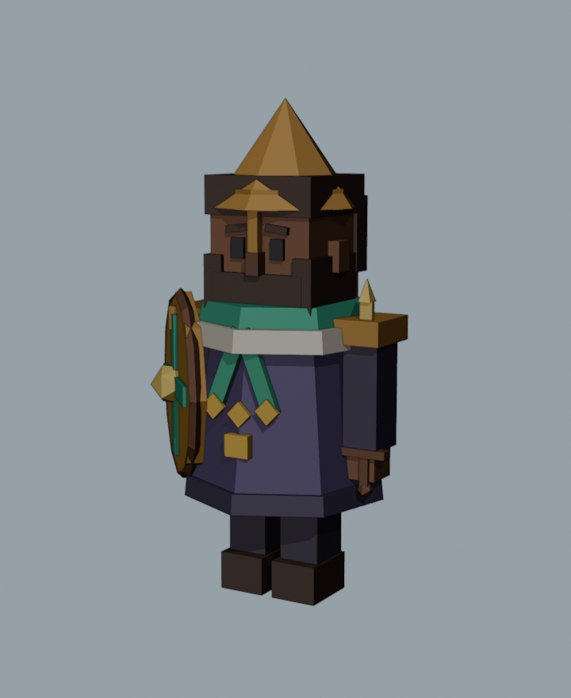

# OBA-Tales modelleri



## Blender ile karakterleri düzenlemek (önerilen yol)

`OBA-Tales-karakter-kit.blend`, haritadaki karakterlerin bütün parçalarını içeren Blender dosyasıdır. Bir parçayı
burada değiştirip oyuna aktarınca **haritadaki binlerce takipçinin hepsi** yeni şekille görünür. Herkesin kendi
renkleri, sınıfı, başlığı ve yürüyüşü aynen kalır; yalnızca şekil değişir.

### Adım adım

1. **Aç:** `modeller/OBA-Tales-karakter-kit.blend` dosyasına çift tıkla (Blender 5.0 ya da daha yenisi).
   Açılışta tolgalı, kılıçlı, kalkanlı bir Kalkaneri görürsün.
2. **Parçayı bul:** Sağ üstteki **Outliner**'da `COL_KIT` altında gruplar var (`COL_01_Govde`, `COL_02_Yuz`,
   `COL_04_Baslik` …). Börk, yay, kopuz gibi öteki seçenekler gizli; görmek için göz simgesine tıkla.
3. **Düzenle:** Parçayı seç, `Tab` ile Edit Mode'a geç.

   | Tuş | İş |
   |---|---|
   | `G` / `R` / `S` | taşı / döndür / ölçekle (ardından `X`, `Y`, `Z` ile ekseni kilitle) |
   | `E` | extrude (yüzeyi dışarı çek) |
   | `Ctrl+R` | loop cut (yeni kesik) |
   | `1` / `2` / `3` (Edit Mode) | nokta / kenar / yüz seçimi |
   | Numpad `1` / `3` / `7` | ön / yan / üst görünüm |
   | `Shift+D` | çoğalt (kopya aynı parçaya sayılır) |
   | `Shift+A` | yeni şekil ekle |
   | `Ctrl+Z` | geri al |

4. **Kaydet:** `Ctrl+S`.
5. **Oyuna aktar:** Üstteki **Scripting** sekmesine geç. Metin düzenleyicide `OBA-Tales_oyuna_aktar.py` açık değilse
   listeden seç, **▶ Run Script**'e bas (ya da `Alt+P`). Çıktı `public/models/karakter-kit.glb` olur. Açılan küçük
   pencere parça ve üçgen sayısını gösterir.
   Komut satırından da aynısı: `npm run blender:aktar`.
6. **Bak:** `npm run dev` açıkken tarayıcıda sayfayı yenile.
7. **Denetle:** Hangi parçanın değiştiğini ve ölçü sorunlarını gösterir:

   ```powershell
   npm run blender:kontrol
   ```

8. **Yayına al:** `public/models/karakter-kit.glb` dosyasını commit edip push'la; site kendini günceller.

**Geri dönmek:** `public/models/karakter-kit.glb` dosyasını silersen oyun koddaki karakterlere döner.
Blender dosyasını sıfırdan kurmak için `npm run blender:kit -- --yenile` kullan; eski dosya
`OBA-Tales-karakter-kit-yedek-<tarih>.blend` olarak saklanır. `--yenile` olmadan var olan dosyaya hiç dokunulmaz.

### Kurallar

- **Adlar:** Nesnenin adı ve `oba_parca` özelliği (Object Properties → Custom Properties) oyundaki parça
  kimliğidir: `kafa`, `govde`, `kalkan`, `yay` … Oyun parçayı bundan tanır ve takipçinin rengini ona verir.
  `kafa.001` gibi kopyalar ve `kafa` nesnesinin altına bağlanan (parent) nesneler de kafaya sayılır.
  Adı tanınmayan nesne oyuna girmez; kontrol betiği onu sana söyler.
- **Renk:** Blender'daki renkler yalnızca seni yönlendirmek için. Oyunda her takipçinin rengi kendi portresinden
  gelir. Bir parçada iki renk istiyorsan onu iki parçaya ayır (kalkan + kalkan-amblemi gibi).
- **Yön ve ölçü:** Karakter `-Y` yönüne bakar (Numpad `1` önden gösterir). Ayak tabanı `z = 0`, boy yaklaşık 4,4 m.
  1 Blender metresi oyunda 1 birimdir. Ölçeği değiştirme.
- **Kollar ve bacaklar:** `COL_REFERANS` içindeki `OMUZ_+X`, `OMUZ_-X` ve `KALCA` noktalarına bak.
  - Kollar omuz noktasından döner. Bunlar: kollar, eller, omuzluk, kalkan, kılıç, balta, yay, kiriş, bileklik, fener,
    kopuz, asa.
  - Bacaklar kalçadan döner. Bunlar: bacaklar, çizmeler, çizme kürkü.
  - Her parça `x = 0`'ın kendi tarafında kalsın. `x > 0` tarafı `+X` koluyla ve bacağıyla birlikte hareket eder.
- **Az poligon:** Haritada aynı anda binlerce karakter çiziliyor.
  - Tek bir parça en fazla 350 üçgen olsun.
  - Bir karakterin açık parçaları toplamda 1500 üçgeni geçmesin. Şu an 784.
  - Düz gölge (Shade Flat) kullan. Subdivision Surface kullanma.
- **Değiştiriciler:** Mirror, Bevel ve Solidify serbest; oyuna aktarırken uygulanırlar. Nesneyi taşıyıp döndürmen
  de sorun değil.
- **Silmek:** Bir parçayı silersen oyun o parçayı koddaki şekliyle çizer.
- **Kod gerektirenler:** Yeni bir seçenek (örneğin yeni bir başlık türü ya da kadroya özel bir parça) hangi takipçide
  görüneceğine dair bir kural ister. Modelini yap, adını söyle, kuralı ben eklerim.

### Dosyalar ve komutlar

| Ne | Nerede |
|---|---|
| Blender dosyası (düzenlediğin) | `modeller/OBA-Tales-karakter-kit.blend` |
| Oyuna giden dosya | `public/models/karakter-kit.glb` |
| Parça listesi, koddaki şekiller | `modeller/kit.json` (`npm run modeller` üretir) |
| Kiti kuran betik | `scripts/blender/kit_olustur.py` (`npm run blender:kit`) |
| Aktaran betik | `scripts/blender/oyuna_aktar.py` (Blender içinde de gömülü) |
| Oyundaki yükleyici | `src/world3d/characters/kitModel.ts`, `useKitModel.ts` |

Blender kendiliğinden bulunur (`C:\Program Files\Blender Foundation\Blender X.Y\`). Başka bir yerdeyse `.env.local`
dosyasına `BLENDER_PATH=C:\…\blender.exe` satırını ekle.

Aktarım ayarları (blender-skills rehberindeki web/oyun önerileriyle aynı):
- glTF ikili (GLB), +Y Up.
- Dönüşümler ve değiştiriciler uygulanmış.
- Malzeme, doku koordinatı ve normal yok; oyun düz gölgeyi kendisi hesaplar.
- Nesne özellikleri glTF `extras` olarak taşınır.

### Claude ile Blender'da birlikte çalışmak (isteğe bağlı)

[arjun988/blender-skills](https://github.com/arjun988/blender-skills), Claude Code için hazırlanmış 94 Blender
becerisinden oluşan bir paket (MIT lisanslı).
- **Kapsamı:** low-poly modelleme, malzeme, ışık, animasyon, dışa aktarım.
- **Nasıl çalışır:** Blender'ın içine kurulan **Blender MCP** eklentisi Claude'u açık Blender'a bağlar. Böylece
  "kalkanı daha oymalı yap" dediğinde Claude sahneyi görür ve parçayı doğrudan Blender'da düzenler.
- **Kurulum:** Bunun için `uv` aracı, Blender eklentisi ve beceriler kurulmalı. İstersen söyle, kurulumu birlikte
  yapalım.
- **Bu kite zaten uygulananlar:** Paketin önerileri kullanıldı.
  - GLB'de +Y Up ve uygulanmış dönüşümler.
  - Low-poly bütçesi ve düz gölge.
  - `COL_` önekli koleksiyon adları.
  - Siluet denetimi (önizleme görseli).

---

## `referans/`: OBJ çıktısı (Blockbench ve öteki programlar için)

Aynı karakterler OBJ olarak da var: üzerine kendi modelini yapman için kalıp. Yeniden üretmek için:

```powershell
npm run modeller
```

| Dosya | Ne |
|---|---|
| `taban.obj` | Yalnızca ortak gövde (bacak, çizme, kaftan, kollar, eller, kafa, yüz, saç). En iyi başlangıç kalıbı |
| `kalkaneri.obj` | Tolgalı, kılıçlı, kalkanlı, kısa sakallı Kalkaneri |
| `kalkaneri-borklu-baltali.obj` | Börklü, baltalı, uzun sakallı Kalkaneri |
| `okyeli.obj` | Tüylü başlıklı, yaylı, okluklu Okyeli |
| `ocakcan.obj` | Kalpaklı, fenerli, kopuzlu, davullu Ocakcan |
| `efsanevi-ocakcan.obj` | Efsanevi nadirlik: uzun pelerin, altın etek, madalyon, runlar |
| `kadro-*.obj` | Yedi kahraman (Baturay, Dede Toygar, Alptuğ, Süheyla, Kürşat, Yalvaç, Işıkay) |
| `blockbench/` | Aynı dosyalar 10 kat büyük (boy ≈ 44 birim): Blockbench'te rahat çalışılır |

Her OBJ'nin yanında aynı adlı `.mtl` dosyası renkleri taşır; ikisini aynı klasörde tut.

**Ölçüler (oyun ekseni):** ayak tabanı `y = 0`, yüz `+z` yönünde, boy ≈ 4,4 birim (blockbench sürümünde ≈ 44).
Omuz eklemi `x = ±0,82, y = 2,62`; kalça `y = 1`.

**Blockbench'te açmak:**
1. **File → New → Generic Model** ile yeni bir model aç.
2. **File → Import → Import OBJ Model** ile `modeller/referans/blockbench/kalkaneri.obj` dosyasını al.
3. Parçalar Outliner'da adlarıyla görünür.

Blockbench'te yaptığın parçayı oyuna koymak için:
1. Parçayı OBJ olarak dışa aktar.
2. Blender kitinde **File → Import → Wavefront (.obj)** ile içeri al. Blockbench sürümünü kullandıysan 0,1 ile ölçekle.
3. Eski parçanın yerine koy, parçanın adını ver.
4. Yukarıdaki 5. adımla oyuna aktar.
