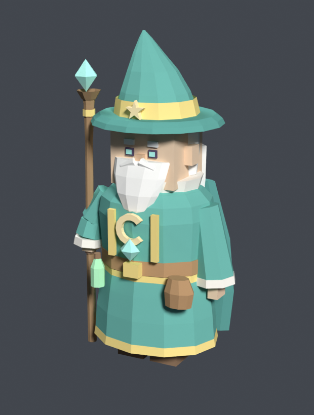

# OBA-Tales modelleri


## Blender ile karakterleri düzenlemek (önerilen yol)

`OBA-Tales-karakter-kit.blend`, haritadaki karakterlerin bütün parçalarını içeren Blender dosyasıdır. Bir parçayı
burada değiştirip oyuna aktarınca **haritadaki binlerce takipçinin hepsi** yeni şekille görünür. Herkesin kendi
renkleri, sınıfı, başlığı ve yürüyüşü aynen kalır; yalnızca şekil değişir.

### Adım adım

1. **Aç:** `modeller/OBA-Tales-karakter-kit.blend` dosyasına çift tıkla (Blender 5.0 ya da daha yenisi).
   Açılışta tolgalı, kılıçlı, kalkanlı bir Kalkaneri görürsün.
2. **Parçayı bul:** Sağ üstteki **Outliner**'da `COL_KIT` altında gruplar var (`COL_01_Govde`, `COL_02_Yuz`,
   `COL_04_Baslik` …). Börk, yay, kopuz gibi öteki seçenekler gizli; görmek için göz simgesine tıkla.
3. **Düzenle:** Parçayı seç, `Tab` ile Edit Mode'a geç.

   | Tuş | İş |
   |---|---|
   | `G` / `R` / `S` | taşı / döndür / ölçekle (ardından `X`, `Y`, `Z` ile ekseni kilitle) |
   | `E` | extrude (yüzeyi dışarı çek) |
   | `Ctrl+R` | loop cut (yeni kesik) |
   | `1` / `2` / `3` (Edit Mode) | nokta / kenar / yüz seçimi |
   | Numpad `1` / `3` / `7` | ön / yan / üst görünüm |
   | `Shift+D` | çoğalt (kopya aynı parçaya sayılır) |
   | `Shift+A` | yeni şekil ekle |
   | `Ctrl+Z` | geri al |

4. **Kaydet:** `Ctrl+S`.
5. **Oyuna aktar:** Üstteki **Scripting** sekmesine geç. Metin düzenleyicide `OBA-Tales_oyuna_aktar.py` açık değilse
   listeden seç, **▶ Run Script**'e bas (ya da `Alt+P`). Çıktı `public/models/karakter-kit.glb` olur. Açılan küçük
   pencere parça ve üçgen sayısını gösterir.
   Komut satırından da aynısı: `npm run blender:aktar`.
6. **Bak:** `npm run dev` açıkken tarayıcıda sayfayı yenile.
7. **Denetle:** Hangi parçanın değiştiğini ve ölçü sorunlarını gösterir:

   ```powershell
   npm run blender:kontrol
   ```

8. **Yayına al:** `public/models/karakter-kit.glb` dosyasını commit edip push'la; site kendini günceller.

**Geri dönmek:** `public/models/karakter-kit.glb` dosyasını silersen oyun koddaki karakterlere döner.
Blender dosyasını sıfırdan kurmak için `npm run blender:kit -- --yenile` kullan; eski dosya
`OBA-Tales-karakter-kit-yedek-<tarih>.blend` olarak saklanır. `--yenile` olmadan var olan dosyaya hiç dokunulmaz.

### Kurallar

- **Adlar:** Nesnenin adı ve `oba_parca` özelliği (Object Properties → Custom Properties) oyundaki parça
  kimliğidir: `kafa`, `govde`, `kalkan`, `yay` … Oyun parçayı bundan tanır ve takipçinin rengini ona verir.
  `kafa.001` gibi kopyalar ve `kafa` nesnesinin altına bağlanan (parent) nesneler de kafaya sayılır.
  Adı tanınmayan nesne oyuna girmez; kontrol betiği onu sana söyler.
- **Renk:** Blender'daki renkler yalnızca seni yönlendirmek için. Oyunda her takipçinin rengi kendi portresinden
  gelir. Bir parçada iki renk istiyorsan onu iki parçaya ayır (kalkan + kalkan-amblemi gibi).
- **Yön ve ölçü:** Karakter `-Y` yönüne bakar (Numpad `1` önden gösterir). Ayak tabanı `z = 0`, boy yaklaşık 4,4 m.
  1 Blender metresi oyunda 1 birimdir. Ölçeği değiştirme.
- **Kollar ve bacaklar:** `COL_REFERANS` içindeki `OMUZ_+X`, `OMUZ_-X` ve `KALCA` noktalarına bak.
  - Kollar omuz noktasından döner. Bunlar: kollar, eller, omuzluk, kalkan, kılıç, balta, yay, kiriş, bileklik, fener,
    kopuz, asa.
  - Bacaklar kalçadan döner. Bunlar: bacaklar, çizmeler, çizme kürkü.
  - Her parça `x = 0`'ın kendi tarafında kalsın. `x > 0` tarafı `+X` koluyla ve bacağıyla birlikte hareket eder.
- **Az poligon:** Haritada aynı anda binlerce karakter çiziliyor.
  - Tek bir parça en fazla 350 üçgen olsun.
  - Bir karakterin açık parçaları toplamda 1500 üçgeni geçmesin. Şu an Kalkaneri 784, büyücü-şifacı 2064 (daha az
    kişide göründüğü için sorun değil).
  - Düz gölge (Shade Flat) kullan. Subdivision Surface kullanma.
- **Değiştiriciler:** Mirror, Bevel ve Solidify serbest; oyuna aktarırken uygulanırlar. Nesneyi taşıyıp döndürmen
  de sorun değil.
- **Silmek:** Bir parçayı silersen oyun o parçayı koddaki şekliyle çizer.
- **Kod gerektirenler:** Yeni bir seçenek (örneğin yeni bir başlık türü ya da kadroya özel bir parça) hangi takipçide
  görüneceğine dair bir kural ister. Modelini yap, adını söyle, kuralı ben eklerim.

### Takipçi modelleri (Savaşçı, Okçu, Büyücü)

Haritadaki takipçiler artık sınıflarının hazır modelini giyiyor. Kaynak dosyalar `modeller/kaynak/takipciler/` içinde,
`29+2/final_output` klasöründen kopyalandı.

| Sınıf | Model | Sıradan | Nadir | Destansı | Efsanevi |
|---|---|---|---|---|---|
| Kalkaneri | `warrior-*` | common | rare | epic | epic (Legendary gelene kadar) |
| Okyeli | `ranger-*` | common | rare | epic | epic (Legendary gelene kadar) |
| Ocakcan | `mage-*` | common | rare | epic | büyücü-şifacı |

- **Ortak gövde:** Bir sınıfın gövdesi, yüzü ve saçı kademeler arasında ortaktır; oyunda bir kez çizilir, rengi
  kademeye göre değişir. Ekipman (zırh, kalkan süsleri, pelerin…) kademe yükseldikçe eklenir.
- **Herkes başka görünür:** Ten ve saç rengi her takipçinin kendisinden gelir. Kumaş ve zırh renkleri modeldeki gibi kalır.
- **Hareket:** Kollar ve bacaklar modelin kendi iskeletinden döner: omuz (±0,55; 2,93), kalça 1,8. Ayarı
  `characterMaterials.ts` → `FOLLOWER_JOINTS` içinde.
- **Uzaklık kademeleri:**
  - En uzakta modelin yerine sınıf ve kademe renginde 4 kutuluk bir siluet çizilir (`-uzak-` parçalar).
  - Orta mesafede asıl model gelir.
  - Perçin, nakış, süsleme ve taş gibi küçük süsler yalnızca yakından çizilir.
  - Kamera dışındaki takipçiler hiç çizilmez.
- **Blender'da:** Parçalar `COL_14_Takipci_kalkaneri`, `_okyeli`, `_ocakcan` gruplarında. Kademeye özel parçaların adında
  kademesi yazar, örneğin `kalkaneri-kalkan-nadir-destansi`.

Modeli değiştirmek ya da yeni kademe eklemek için:
1. OBJ'yi `modeller/kaynak/takipciler/` içinde aynı adla değiştir.
2. Kodu yeniden üret:

   ```powershell
   npm run model:takipciler
   ```

   Dönüştürücü ters dönmüş yüzleri kendisi düzeltir (oyun yüzlerin arkasını çizmediği için bunlar delik gibi
   görünür; Kalkaneri perçemleri öyleydi). Kontrolü `npm test` yapar.

### Efsanevi takipçiler (Legendary)

Efsanevi modellerin kaynağı bir betiktir: `scripts/efsanevi-takipciler.ts`. Destansı modelin üstüne kurar (aynı gövde ve
iskelet), renkleri kızıl, altın, fildişi ve kor ışığına çevirir ve kodla çizilmiş yeni parçalar ekler:

| Sınıf | Görünüş | Yeni parçalar |
|---|---|---|
| Kalkaneri · Alp | altın tolga, kızıl yele, uzun kızıl pelerin | `tolga`, `tolga-bandi`, `tolga-sorgucu`, `tolga-yelesi`, `pelerin`, `pelerin-kenari`, `kilic-isigi`, `kalkan-isigi`, `kalkan-gunesi` |
| Okyeli · Kartal | fildişi kapüşon, kartal tüyü tacı, kürk yaka, altın yay | `kartal-tuy`, `omuz-kurku`, `yay-isigi` (ışıyan kiriş), `yay-uclari` |
| Ocakcan · Ocak Ata | sırtta ateş halesi, alevli asa ve şapka | `ates-halesi`, `asa-alevi`, `sapka-alevi`, `madalyon`, `madalyon-tasi` |

Efsanevi Ocakcanların üçte biri büyücü-şifacı modelini giymeye devam eder.

Değiştirmek için betikteki renkleri ya da parçaları düzenle, sonra:

```powershell
npm run model:efsanevi
```

```powershell
npm run model:takipciler
```

İlki `modeller/kaynak/takipciler/<sinif>-legendary.obj` dosyalarını yazar (Blockbench ya da Blender'da açılır), ikincisi
oyuna bağlar. Kendi efsanevi modelini yaparsan aynı adla o klasöre koyup yalnızca ikinci komutu çalıştır; o zaman betiği
bir daha çalıştırma, yoksa modelinin üstüne yazar.

### Tam yeni bir karakter modeli: büyücü-şifacı



Senin yaptığın büyücü-şifacı modeli oyunda.
- **Kimler giyer:** Efsanevi Ocakcanlar ile Dede Toygar (destansı Ocakcanlar artık büyücü takipçi modelini giyer). Bu karakterler ortak gövde yerine bu modeli
  giyer: sivri şapka, cüppe, sakal, ay amblemi, taşlı asa, iksir ve kese.
- **Renkler:** Her takipçinin kendi renkleri kullanılır. Cüppe ve şapka kaftan rengini, süsler altın rengini, uzun
  pelerin nadirlik rengini alır.
- **Nadirliğe göre farklar:** Pelerin runları yalnızca efsanevilerde var.
- **Kalanlar:** Öteki kadro üyeleri ve sıradan ya da nadir Ocakcanlar eski görünüşünde.

| Ne | Nerede |
|---|---|
| Senin dosyan (kopya, asıl klasöre dokunulmadı) | `modeller/kaynak/buyucu-sifaci.obj` |
| Oyundaki kod geometrisi (üretilmiş) | `src/world3d/characters/models/buyucuSifaci.ts` |
| Kimin giydiği, renkler | `src/world3d/characters/characterKit.ts` → `WIZARD`, `kitChoice().wizard` |

Modeli değiştirmenin iki yolu var.
- **Blender'da:** Parçalar Blender kitinde `COL_10_Buyucu-sifaci` grubunda, adları `buyucu-` ile başlıyor.
  Düzenleyip `Alt+P` ile aktarman yeterli.
- **OBJ'yi yenileyerek:** Önce `modeller/kaynak/buyucu-sifaci.obj` dosyasını yenile, sonra kodu yeniden üret:

  ```powershell
  npm run model:cevir -- modeller/kaynak/buyucu-sifaci.obj buyucuSifaci
  ```

**Yeni bir model getirirken:**
- Blockbench kalıbından (10 kat büyük) çalış.
- Parça adlarını yukarıdaki kurallara göre ver.
- Dosyayı `modeller/kaynak/` klasörüne koy.
- Kimin giyeceğini söyle, kuralını ben eklerim.
- Doku (UV ve basecolor) kullanılmaz: oyunda her parçayı takipçinin rengi boyar.

### Özel kahramanlar: egetunce, mhellingtr ve BinTaş

Üç özel kahramanın parçaları Blender kitinde ayrı gruplarda duruyor:
- `COL_11_egetunce`: kova şapka ve gözleri, lavanta, uzun Gün Kılıcı.
- `COL_12_mhellingtr`: yıldızlı altın hale, göğüs yıldızı, beyaz tabard, takımyıldızlı uzun pelerin, kristal oklar, yay uçlarındaki yıldızlar (okçu gövdesinin üstüne).
- `COL_13_BinTas`: senin alev kadını modelin (`modeller/kaynak/efsanevi-alev-kadini.obj`). Renkleri modeldeki gibi.

Parça adları `egetunce-`, `mhellingtr-` ve `bintas-` ile başlıyor. Düzenleyip `Alt+P` ile aktarman yeterli. Renkleri 2D portreyle aynı yerden geliyor:
`src/game/sprites/composeSprite.ts` → `CAST_LOOKS`.

### Kahramanların iskeleti ve animasyonları

Haritada yürüyen, koşan, el sallayan üç kahraman iskeletli ve animasyonludur. Her biri kendi dosyasındadır:
`public/models/kahraman-<kimlik>.glb`. Yeniden üretmek için:

```powershell
npm run blender:kahramanlar
```

Yalnızca birini üretmek için (örnek BinTaş):

```powershell
npx tsx scripts/blender/calistir.ts kahramanlar bintas
```

Betik (`scripts/blender/kahraman_iskelet.py`) sırayla şunları yapar:
1. Oyundaki modeli `modeller/referans/kadro-<kimlik>.obj` olarak alır (`npm run modeller` yazar). Parça içinde çakışan
   köşeleri kaynaştırır.
2. 20 kemiklik bir iskelet kurar: kalça, bel, göğüs, boyun, kafa; iki yanda omuz, ön kol, el; uyluk, baldır, ayak;
   pelerin için iki kemik. BinTaş'ın iskeleti farklıdır: bir kolu küreyi havada tutar.
3. Her köşeyi en yakın kemiğe bağlar. Eklem yerlerinde iki kemik yumuşakça paylaşır.
4. 13 klibi kodla yazar ve GLB'ye aktarır.
5. Kontrol için bir önizleme sayfası çizer: `modeller/kahramanlar/<kimlik>-onizleme.png` (14 kare, her klipten bir an).

| Klip | Ne zaman |
|---|---|
| `bosta` | dururken nefes alır |
| `yuru`, `kos` | gezinirken; hız ayak adımına göre ayarlanır, ayak kaymaz |
| `balta` | ağaç keser |
| `yay` | germe, nişan, bırakma |
| `topla` | çömelip bitki toplar |
| `tasi` | sırtta odun ya da av |
| `otur`, `sohbet` | ateş başında |
| `selam` | kameraya el sallar |
| `esne` | uyanınca esner (bir kez oynar) |
| `cadir` | çadıra eğilip girer |
| `yika` | derede yüz yıkar |

Bir klibi değiştirmek için betikteki `clip_<ad>` işlevindeki açıları değiştir. Açılar derece cinsindendir: öne eğme,
yana açma, kendi ekseninde dönme. Sonra komutu yeniden çalıştırıp önizleme sayfasına bak.

Oyunda:
- Yükleyici `src/world3d/story/heroModel.ts`. Renkler ve parıltı oyundaki parça listesinden gelir, Blender'daki renk
  yalnızca yedektir.
- Sahnedeki kahraman `src/world3d/story/AnimatedHero.tsx`. Klipler arasında 0,25 sn yumuşak geçiş olur.
- Hangi klibin hangi hızda oynayacağı `src/world3d/story/heroMotion.ts` içinde.
- GLB yoksa ya da bozuksa kahraman eski kalabalık çiziminde görünür, site bozulmaz.
- Oyunda renk parçaları tek ağda birleşir, renkler köşelere yazılır (`src/world3d/story/mergeSkinned.ts`). Bu yüzden
  Blender'da parça (malzeme) eklemek çizim sayısını artırmaz. Yalnızca malzeme adı oyundaki parça listesinde olmalı.

### Hayvanlar: geyik, tavşan, kuş

Av çayırının hayvanları da Blender'da koddan kurulur. Hepsi düşük poligonlu ve iskeletli; her parça bir kemiğe
bağlıdır. Yeniden üretmek için:

```powershell
npm run blender:hayvanlar
```

Yalnızca birini üretmek için (örnek kuş):

```powershell
npx tsx scripts/blender/calistir.ts hayvanlar kus
```

| Tür | Klipler | Üçgen |
|---|---|---|
| geyik | `dur`, `otla`, `yuru`, `kos`, `yigil` | 452 |
| tavşan | `bekle`, `kemir`, `zipla`, `kac`, `yigil` | 216 |
| kuş | `dur`, `gagala`, `kanat`, `suzul`, `yigil` | 180 |

- `yigil` bir kez oynar ve son karesinde kalır: avlanan hayvan yere yığılır, kan yok.
- Betik `scripts/blender/hayvanlar.py`. Gövde parçaları, renkleri ve kemikleri dosyanın başındaki `SPECIES` içinde;
  klipler `deer_clips`, `rabbit_clips`, `bird_clips` işlevlerinde.
- Çıktılar `public/models/hayvan-<tür>.glb` ve önizleme `modeller/hayvanlar/<tür>-onizleme.png`.
- Boynuzlar geyik modelinde hep var. Oyunda yalnızca sürünün başındaki erkek geyikte görünür, bu geyik avlanmaz.

### Dosyalar ve komutlar

| Ne | Nerede |
|---|---|
| Blender dosyası (düzenlediğin) | `modeller/OBA-Tales-karakter-kit.blend` |
| Oyuna giden dosya | `public/models/karakter-kit.glb` |
| Parça listesi, koddaki şekiller | `modeller/kit.json` (`npm run modeller` üretir) |
| Kiti kuran betik | `scripts/blender/kit_olustur.py` (`npm run blender:kit`) |
| Aktaran betik | `scripts/blender/oyuna_aktar.py` (Blender içinde de gömülü) |
| Oyundaki yükleyici | `src/world3d/characters/kitModel.ts`, `useKitModel.ts` |
| İskeletli kahramanlar | `public/models/kahraman-<kimlik>.glb` (`npm run blender:kahramanlar`) |
| İskelet ve klipleri kuran betik | `scripts/blender/kahraman_iskelet.py` |
| Klip önizlemeleri | `modeller/kahramanlar/<kimlik>-onizleme.png` |
| Hayvanlar | `public/models/hayvan-<tür>.glb` (`npm run blender:hayvanlar`, betik `scripts/blender/hayvanlar.py`) |

Blender kendiliğinden bulunur (`C:\Program Files\Blender Foundation\Blender X.Y\`). Başka bir yerdeyse `.env.local`
dosyasına `BLENDER_PATH=C:\…\blender.exe` satırını ekle.

Aktarım ayarları (blender-skills rehberindeki web/oyun önerileriyle aynı):
- glTF ikili (GLB), +Y Up.
- Dönüşümler ve değiştiriciler uygulanmış.
- Malzeme, doku koordinatı ve normal yok; oyun düz gölgeyi kendisi hesaplar.
- Nesne özellikleri glTF `extras` olarak taşınır.

### Claude ile Blender'da birlikte çalışmak (isteğe bağlı)

[arjun988/blender-skills](https://github.com/arjun988/blender-skills), Claude Code için hazırlanmış 94 Blender
becerisinden oluşan bir paket (MIT lisanslı).
- **Kapsamı:** low-poly modelleme, malzeme, ışık, animasyon, dışa aktarım.
- **Nasıl çalışır:** Blender'ın içine kurulan **Blender MCP** eklentisi Claude'u açık Blender'a bağlar. Böylece
  "kalkanı daha oymalı yap" dediğinde Claude sahneyi görür ve parçayı doğrudan Blender'da düzenler.
- **Bu kite zaten uygulananlar:** Paketin önerileri kullanıldı.
  - GLB'de +Y Up ve uygulanmış dönüşümler.
  - Low-poly bütçesi ve düz gölge.
  - `COL_` önekli koleksiyon adları.
  - Siluet denetimi (önizleme görseli).

**Kurulu olanlar (25 Kasım 2026):**

| Ne | Nerede |
|---|---|
| `uv` | winget ile kurulu |
| Blender eklentisi **MCP for Blender** 2.3.1 ([ahujasid](https://github.com/ahujasid/blender-mcp), eski adı blender-mcp) | `%APPDATA%\Blender Foundation\Blender\5.0\scripts\addons\blender_mcp.py`, Preferences → Add-ons'ta açık |
| Claude Code'daki `blender` MCP sunucusu | Yalnızca bu projede ve yalnızca sende (`local` kapsam, `~/.claude.json`) |
| 94 beceri | `.claude/skills/` (bu projede, git'e eklenmedi) |

**Kullanmak:**
1. Kit dosyasını Blender'da aç. Eklenti sunucuyu kendiliğinden başlatır ve yalnızca bu bilgisayardan bağlantı
   kabul eder (`localhost:9876`). Durumu 3D görünümde `N` → **MCP for Blender** sekmesinde görürsün; kapalıysa
   **Start MCP Server**'a bas.
2. Claude Code'da bu projede **yeni bir oturum** aç. MCP araçları oturum açılırken yüklenir.
3. İsteğini yaz, örneğin "kalkanı daha oymalı yap". Claude sahnedeki nesneleri listeler, Blender'da Python
   çalıştırarak düzenler ve görüntüyle kontrol eder.
4. Beğenirsen `Ctrl+S` ile kaydet ve yukarıdaki 5. adımla oyuna aktar. Beğenmezsen `Ctrl+Z` ile geri al.

**Dikkat:**
- Claude'un yaptığı her değişiklik açık dosyadadır. Büyük bir işten önce `.blend` dosyasının kopyasını al.
- Telemetri iki yerde de kapalı: sunucuda `DISABLE_TELEMETRY=true`, eklentide **Allow Telemetry** kapalı
  (varsayılan).
- Eklentideki Sketchfab, Hyper3D, Meshy gibi dış hizmetler API anahtarı ister. Anahtar girmedikçe çalışmazlar.

**Komutlar:**

```powershell
claude mcp get blender
```

Başka bir bilgisayarda kurmak için önce eklentiyi kopyala, sonra Blender'da Preferences → Add-ons'tan
**Interface: MCP for Blender**'ı aç, en son sunucuyu Claude Code'a kaydet:

```powershell
uvx mcp-for-blender@2.3.1 install-addon
```

```powershell
claude mcp add blender -s local -e DISABLE_TELEMETRY=true -e BLENDER_HOST=localhost -e BLENDER_PORT=9876 -- cmd /c uvx mcp-for-blender@2.3.1
```

Sürüm sabitlendi (2.3.1). Güncellerken iki komuttaki sürümü birlikte değiştir: eklenti ile sunucu aynı sürümde
olmalı. Kaldırmak için `claude mcp remove blender -s local` komutunu çalıştır, sonra eklentiyi Blender'da kapat.

**Deneme:** Kurulum günü kitin bir kopyasında `kalkan-kabarasi` MCP üzerinden 1,5 kat büyütüldü ve gömülü
`OBA-Tales_oyuna_aktar.py` ile geçici bir klasöre aktarıldı. `npm run blender:kontrol` sonucu: 71/71 parça
dosyada, 1 parça değişmiş, sorun yok. Asıl `.blend` dosyasına ve `public/models/`'a dokunulmadı.

---

## `referans/`: OBJ çıktısı (Blockbench ve öteki programlar için)

Aynı karakterler OBJ olarak da var: üzerine kendi modelini yapman için kalıp. Yeniden üretmek için:

```powershell
npm run modeller
```

| Dosya | Ne |
|---|---|
| `taban.obj` | Yalnızca ortak gövde (bacak, çizme, kaftan, kollar, eller, kafa, yüz, saç). En iyi başlangıç kalıbı |
| `kalkaneri.obj` | Tolgalı, kılıçlı, kalkanlı, kısa sakallı Kalkaneri |
| `kalkaneri-borklu-baltali.obj` | Börklü, baltalı, uzun sakallı Kalkaneri |
| `okyeli.obj` | Tüylü başlıklı, yaylı, okluklu Okyeli |
| `ocakcan.obj` | Kalpaklı, fenerli, kopuzlu, davullu Ocakcan |
| `efsanevi-ocakcan.obj` | Efsanevi Ocakcan: büyücü-şifacı modeli (sivri şapka, cüppe, asa, iksir, runlu pelerin) |
| `kadro-*.obj` | Yedi kahraman (Baturay, Dede Toygar, Alptuğ, Süheyla, Kürşat, Yalvaç, Işıkay) |
| `blockbench/` | Aynı dosyalar 10 kat büyük (boy ≈ 44 birim): Blockbench'te rahat çalışılır |

Her OBJ'nin yanında aynı adlı `.mtl` dosyası renkleri taşır; ikisini aynı klasörde tut.

**Ölçüler (oyun ekseni):** ayak tabanı `y = 0`, yüz `+z` yönünde, boy ≈ 4,4 birim (blockbench sürümünde ≈ 44).
Omuz eklemi `x = ±0,82, y = 2,62`; kalça `y = 1`.

**Blockbench'te açmak:**
1. **File → New → Generic Model** ile yeni bir model aç.
2. **File → Import → Import OBJ Model** ile `modeller/referans/blockbench/kalkaneri.obj` dosyasını al.
3. Parçalar Outliner'da adlarıyla görünür.

Blockbench'te yaptığın parçayı oyuna koymak için:
1. Parçayı OBJ olarak dışa aktar.
2. Blender kitinde **File → Import → Wavefront (.obj)** ile içeri al. Blockbench sürümünü kullandıysan 0,1 ile ölçekle.
3. Eski parçanın yerine koy, parçanın adını ver.
4. Yukarıdaki 5. adımla oyuna aktar.
